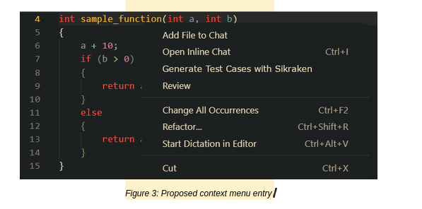
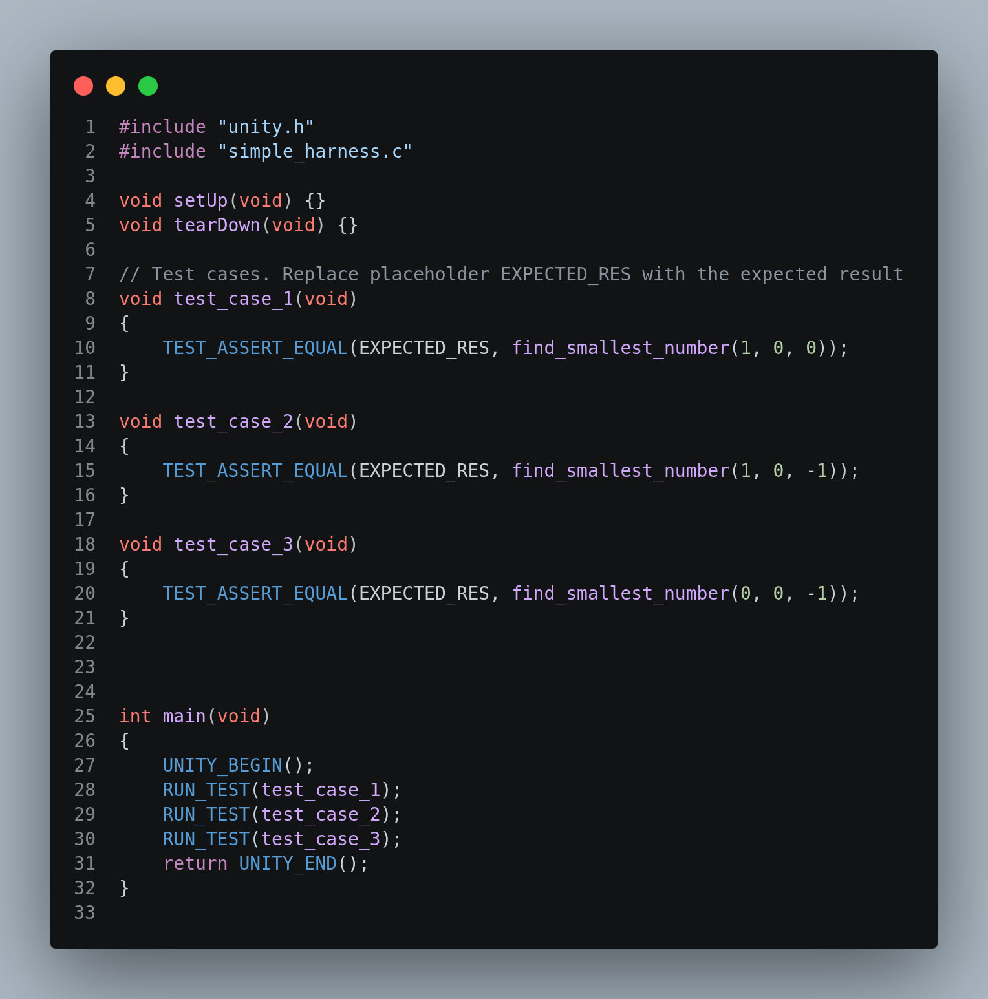

# Sikraken VS Code Extension

The Sikraken extension generates C test inputs and Unity test harnesses from
source files or selected functions. It uses Sikraken symbolic execution to
explore branches and displays the generated inputs in VS Code.

This extension was developed as my final year project.



## Features

- Run Sikraken on the active C file.
- Generate tests for the function containing the cursor.
- Generate Unity test suites from discovered inputs.
- Display generated inputs in a dedicated VS Code output channel.
- Support scalar parameters and return types:
  `char`, `short`, `int`, `long`, `long long`, `float`, and `double`.
- Support valid signed, unsigned, and `const`-qualified scalar forms.



## Installation

### From source

Requirements:

- VS Code `1.140` or newer
- Node.js and npm
- Linux environment for the bundled Sikraken tools

```bash
git clone https://github.com/OliwierJ/Sikraken-extension.git
cd Sikraken-extension
npm install
npm run compile
```

Press `F5` in VS Code to launch the Extension Development Host.

## Usage

1. Open a C file.
2. Place the cursor inside the target function, or use the active file.
3. Right-click and choose **Generate Tests on Function** or **Run Sikraken on File**.
4. Review the generated inputs in the **Sikraken Test Inputs** output channel.

Generated Unity test suites are written beside the source file when using
function generation.

## Limitations

- Only scalar function parameters and return types are currently supported.
- Arrays, pointers, structs, enums, function pointers, and variadic arguments
  are not supported by function generation.
- `void` return types cannot currently produce generated assertions.
- Function generation depends on VS Code's C document symbols.
- The bundled Sikraken command is currently intended for Linux.
- Sikraken may produce fewer tests when analysis time or path complexity is
  high.
