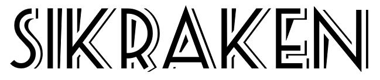

# Sikraken

Sikraken generates test inputs for C programs. It aims for maximal branch coverage or, for an
error-reachability goal, a test that calls a given function (by default `reach_error`). It writes the tests
in the [Test-Comp](https://test-comp.sosy-lab.org/) test-suite format or, in real-code mode (`--function`), as
[Unity](https://www.throwtheswitch.org/unity) tests of one C function.

Author: Dr Christophe Meudec (echancrure@gmail.com).
It is a side project developed in an agile way by a team of one, part time; so don't expect miracles.

The release archive (on Zenodo) is ready to run on Linux x86-64.

## Contents of the release archive

| Path | Contents |
| --- | --- |
| `bin/sikraken.sh` | The tool's entry point (see Usage) |
| `bin/call_parser.sh`, `bin/sikraken_parser.exe` | Preprocesses and parses the C file; called by `sikraken.sh` |
| `bin/run_unity.sh` | Compiles and runs the Unity tests of real-code mode, and measures their coverage with gcov |
| `bin/version.txt` | Version number (first line) and version history |
| `SymbolicExecutor/` | The symbolic executor |
| `PTC-Solver/` | The PTC-Solver constraint solver |
| `eclipse/` | ECLiPSe 7.1 Constraint Programming System (third party, own licence) |
| `properties/` | Test-Comp property files `coverage-branches.prp` and `coverage-error-call.prp` |
| `SampleCode/simple_if.c` | A small example program used by `smoketest.sh` |
| `demo/real_code/` | Four short examples of real-code mode and `run_demo.sh`, which runs them all |
| `Unity/` | The Unity test framework, v2.7.0 (third party, MIT licence: `Unity/LICENSE.txt`) |
| `smoketest.sh` | Runs Sikraken on the example; exits with 0 on success |
| `LICENSE` | Licence for Sikraken and PTC-Solver |
| `Documentation/sikraken_logo.png` | The logo shown in this README |

## Requirements

Linux x86-64 with `bash`, `gcc` (used to preprocess the C file, and in real-code mode to compile the Unity tests;
`gcov` comes with it), `awk`, `timeout` and `prlimit`. Everything else, including ECLiPSe and Unity, is included in
the archive.

## Usage

```
bin/sikraken.sh <mode> <algorithm> [options] <c_file>
bin/sikraken.sh --testcomp [-m32|-m64] --property-file=<file.prp> <c_file>
bin/sikraken.sh --version
bin/sikraken.sh --help
```

- `<mode>`: `release` or `debug` (debug prints much more).
- `<algorithm>`: `budget[S]` searches for up to `S` seconds of CPU time, e.g. `budget[900]`.
- `-m32` (default) or `-m64`: the data model, as for gcc.
- `--property-file=F`: sets the coverage goal from a Test-Comp property file. If `F` does not exist, Sikraken
  looks for a file with the same name in `properties/`.
- `--testcomp`: the settings used in Test-Comp.
- `<c_file>`: the C file (`.c`, or `.i` if already preprocessed), given as an absolute path or relative to the
  current directory. Sikraken can be called from any directory.

`bin/sikraken.sh --help` lists all options.

Example:

```
./smoketest.sh
bin/sikraken.sh release budget[10] --property-file=coverage-branches.prp SampleCode/simple_if.c
```

## Real-code mode

```
bin/sikraken.sh release budget[10] --function list_remove demo/real_code/linked_list.c
bin/run_unity.sh demo/real_code/linked_list.c -64 list_remove
demo/real_code/run_demo.sh
```

`--function NAME` tests one function of the file: its parameters, the memory its pointers point to and the globals
it reads before writing them are its inputs (`--stub NAME` for a function the file declares but does not define, such
as hardware access). The tests are written to `sikraken_output/<name>/unity/test_<name>_<function>.c`, one Unity test
per path, each asserting what the function did; `bin/run_unity.sh` compiles them with Unity, runs them and prints gcov's
coverage. `-m64` is the default in this mode.

## Output

For `<name>.c`, the tests are written to `sikraken_output/<name>/test-suite/` in the installation directory:
`metadata.xml` and one `test_input-<n>.xml` per test. A previous run on a file with the same name is
overwritten. They can be validated with
[TestCov](https://gitlab.com/sosy-lab/software/test-suite-validator).

## Licence

Sikraken and PTC-Solver are licensed under the
[GNU Lesser General Public License v3.0 only](https://www.gnu.org/licenses/lgpl-3.0.html)
(LGPL-3.0-only): see `LICENSE`. The tests Sikraken generates are not restricted in any way. ECLiPSe is
distributed under its own licence: see `eclipse/legal/`. Unity is distributed under the MIT licence: see
`Unity/LICENSE.txt`.

The author asks that Sikraken and PTC-Solver not be used to train AI or machine-learning systems.
